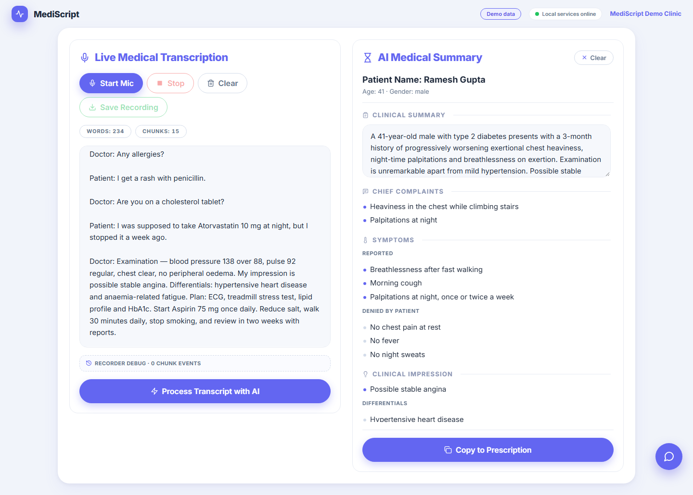
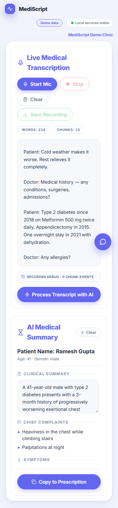
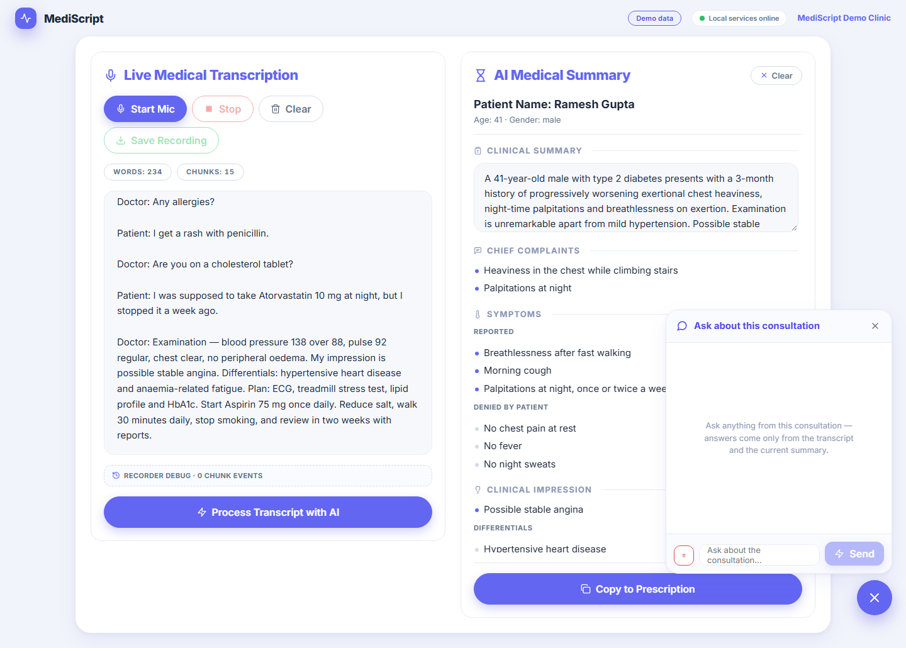
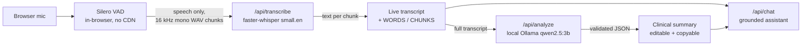
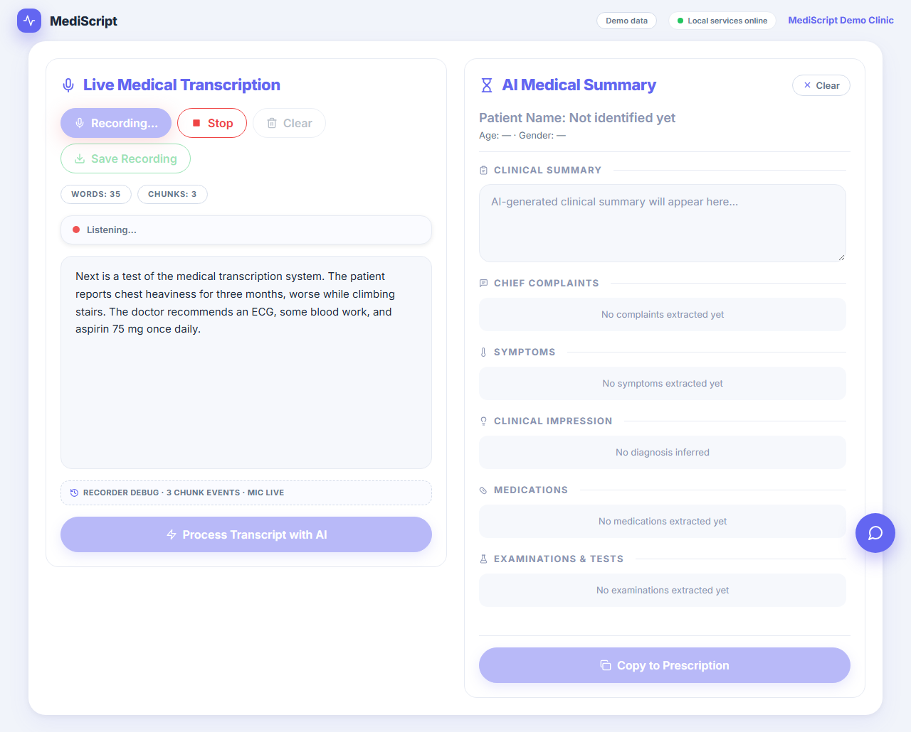
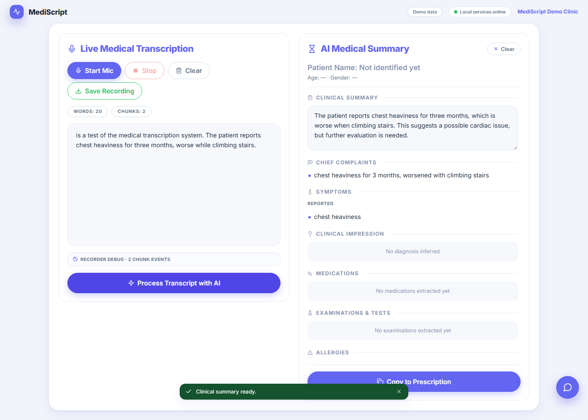

# MediScript — Live Medical Transcription & AI Clinical Summary

<p align="center">
  
</p>

MediScript listens to a doctor–patient consultation through the microphone, filters silence
and background noise with **Silero VAD**, transcribes the speech **live** with
**faster-whisper**, and at the end of the session produces a structured **clinical summary**
with a **local** LLM — plus a transcript-aware assistant you can ask questions.

> **Everything runs on your machine.** No cloud LLM, no API key, no analytics, no storage.
> The transcript never leaves the device.

---

## What you get

| | Feature | Where |
| --- | --- | --- |
| 🎙️ | One click to start — the browser mic streams and **VAD auto-chunks** the speech so silence and noise never reach the recogniser | Left card |
| 📝 | Text appears **live, in order, as you speak**; `WORDS` / `CHUNKS` counters update in real time | Left card |
| 💾 | Save the whole session as a 16 kHz WAV (plus transcript `.txt` if text exists) | Left card |
| 🧠 | **Process Transcript with AI** produces patient details, complaints, symptoms (stated positives *and* negatives), assessment, plan and a record-ready summary — never invented facts | Right card |
| ⌨️ | The summary is **editable** and copies to the clipboard as formatted plain text for a prescription/record | Right card |
| 💬 | Floating **assistant chat** that answers *only* from the transcript and summary — and says so when the answer isn't in them | Bottom-right FAB |

<p align="center">
  
  &nbsp;&nbsp;
  
</p>

---

## 60-second quick start

**Windows**

```bat
run.bat
```

**Linux / macOS**

```bash
./run.sh
```

That single command does **everything**:

1. creates `.env` from `.env.example` (if missing)
2. installs Python + npm dependencies into a virtual env
3. finds, installs and starts **Ollama**, pulls `qwen2.5:3b` (one-time)
4. starts the backend (`http://localhost:8000`) and the app (`http://localhost:5173`)
5. opens the app in your browser

The first start also downloads the Whisper model (~460 MB) automatically in the
background. After that: **click *Start Mic*, speak naturally, watch the transcript
appear, then click *Process Transcript with AI*.**

<details>
<summary>Manual setup (if you prefer)</summary>

```bash
python -m venv backend/.venv
backend/.venv/Scripts/python -m pip install -r backend/requirements.txt   # Windows
backend/.venv/bin/python -m pip install -r backend/requirements.txt       # Linux/macOS

cd frontend && npm install && npm run dev                                  # terminal 1
cd backend && .venv/Scripts/python -m uvicorn app.main:app --port 8000     # terminal 2
```
</details>

<details>
<summary>Prerequisites</summary>

- Node.js 20.19+ / 22+
- Python 3.11+
- [Ollama](https://ollama.com) — installed automatically where possible (may ask for one
  administrator approval on Windows)
- ~6 GB disk for models (Whisper `small.en` ≈ 460 MB, `qwen2.5:3b` ≈ 2 GB) and 8 GB+ RAM
  recommended
</details>

---

## How it works



- **VAD thresholds, not vibes**: 0.45/0.32 with 700 ms redemption, 500 ms pre-speech
  padding and a 400 ms minimum — short noise blips are dropped, natural pauses close
  chunks quickly.
- **Ordered uploads**: stems are transcribed one-at-a-time so the transcript order always
  matches the speech order; a failed chunk gets a toast with a **Retry** button.
- **Schema-honest**: the LLM's JSON is coerced and validated against the `ClinicalSummary`
  Pydantic models before it reaches the UI — anything unstated stays empty, never invented.

---

## What it looks like in practice

| Stage | Screenshot |
| --- | --- |
| Dictating — transcript fills live inside translucent grey panel, counters tick |  |
| After **Process Transcript with AI** — every section grounded in the transcript |  |

---

## Configuration (`.env`) — all optional

| Variable | Default | Purpose |
| --- | --- | --- |
| `WHISPER_MODEL` | `small.en` | Set `small` for non-English speech |
| `WHISPER_DEVICE` | `cpu` | `cpu` or `cuda` |
| `WHISPER_COMPUTE_TYPE` | `int8` | CPU quantisation; `int8_float32` for less precision loss |
| `WHISPER_CPU_THREADS` | `4` | CTranslate2 CPU threads |
| `WHISPER_BEAM_SIZE` | `5` | Lower = faster, less accurate |
| `LLM_BASE_URL` | `http://127.0.0.1:11434/v1` | Any OpenAI-compatible local endpoint |
| `LLM_MODEL` | `qwen2.5:3b` | Model used for analysis + chat |
| `LLM_API_KEY` | `local` | Placeholder; local Ollama ignores it |
| `LLM_TIMEOUT_S` | `180` | Per-request LLM timeout |
| `BACKEND_PORT` / `FRONTEND_PORT` | `8000` / `5173` | Server ports |

## API reference

Interactive docs live at **`/api/docs`** once the backend runs.

| Endpoint | Contract |
| --- | --- |
| `GET /api/health` | `{ status, asr, llm, model_ready }` — `model_ready: true` once Whisper has loaded |
| `POST /api/transcribe` | multipart wav (one 16 kHz mono VAD chunk) → `{ chunk_index, text, duration_ms }` |
| `POST /api/analyze` | `{ transcript }` → validated `ClinicalSummary` JSON |
| `POST /api/chat` | `{ transcript, summary, message }` → `{ reply }` (transcript-grounded only) |
| *any error* | `{ "error": { "code": "...", "message": "..." } }` |

---

## Troubleshooting

| Symptom | Fix |
| --- | --- |
| "Microphone permission denied" toast | Allow the mic in the browser (Chrome/Edge, `localhost` is already secure) and click **Retry** |
| "Backend not reachable" | Start the backend (`run.bat`), then hit **Retry** — the app stays usable either way |
| First *Process with AI* is slow | The Ollama model warms up on first use (~15 s); later requests are ~5–12 s |
| Analysis returns 503 "did not match schema" | Usually transient model drift — press **Retry**; a second attempt is built into the backend |
| Winget installs fail | `winget install --id Ollama.Ollama -e --accept-package-agreements --accept-source-agreements`, then re-run `run.bat` |

---

## Try it without a doctor — or verify the build

Dev builds have a **Demo data** toggle in the top bar that fills the UI with a fictional
consultation so you can explore the summary and chat instantly.

The repo ships its own verification assets (all green at `v1.0.0`):

```bash
# backend contract + behaviour tests
pip install -r backend/requirements-dev.txt
python -m pytest backend/tests -q          # 24 passed

# end-to-end UI suites (Playwright, need servers running)
python docs/verify_step2_recorder.py       # mic + VAD + silent gaps + WAV
python docs/verify_step3_transcribe.py     # live transcript order + counters
python docs/verify_step4_analyze.py        # full pipeline -> real summary
python docs/verify_step5_chat.py           # grounded chat + refusal
```

If your machine has no microphone — every E2E uses a looping spoken WAV fixture, so the
whole pipeline is verifiable headlessly.

---

## Privacy

- Transcript data is treated as **sensitive**: nothing is stored by default, no transcript
  text ever appears in logs, and no request leaves the machine after setup.
- **AI disclaimer:** generated summaries are AI output and must be reviewed by a
  clinician before entering any medical record.

## Tech stack

| Layer | Choice |
| --- | --- |
| Frontend | React + TypeScript + Vite + Zustand, plain CSS variables — port **5173** |
| Backend | Python 3.11+, FastAPI, Pydantic v2, Uvicorn — port **8000** |
| ASR | `faster-whisper` `small.en`, CPU (int8), model auto-downloaded |
| VAD | Silero in the browser (`@ricky0123/vad-web`), assets served locally |
| LLM | Ollama OpenAI-compatible API, model `qwen2.5:3b` |

## Project structure

```
├── AGENTS.md            # PRD sections 1–3 loaded by all agents every session
├── run.sh / run.bat     # one-command autonomous setup + start
├── backend/             # FastAPI app (app/asr.py, app/analyzer.py, app/summary.py)
│   └── requirements-dev.txt   # pytest + httpx for the backend test suite
├── frontend/            # React + TS + Vite app (mic + VAD + uploader + UI)
├── docs/                # handoff notes per step + changelog + E2E scripts
└── .env.example         # every configuration variable, documented
```
